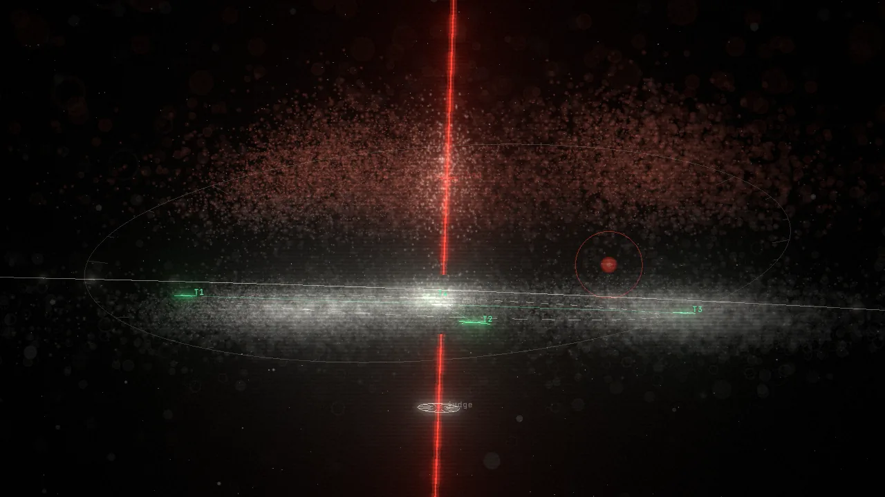
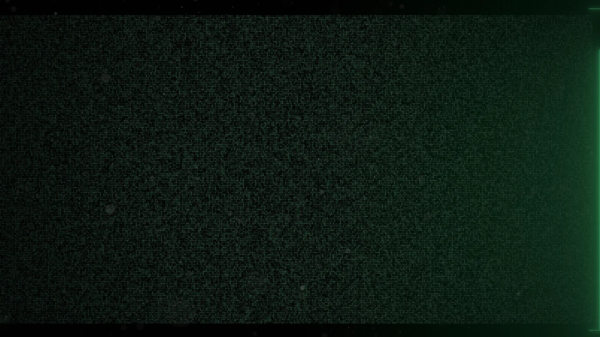
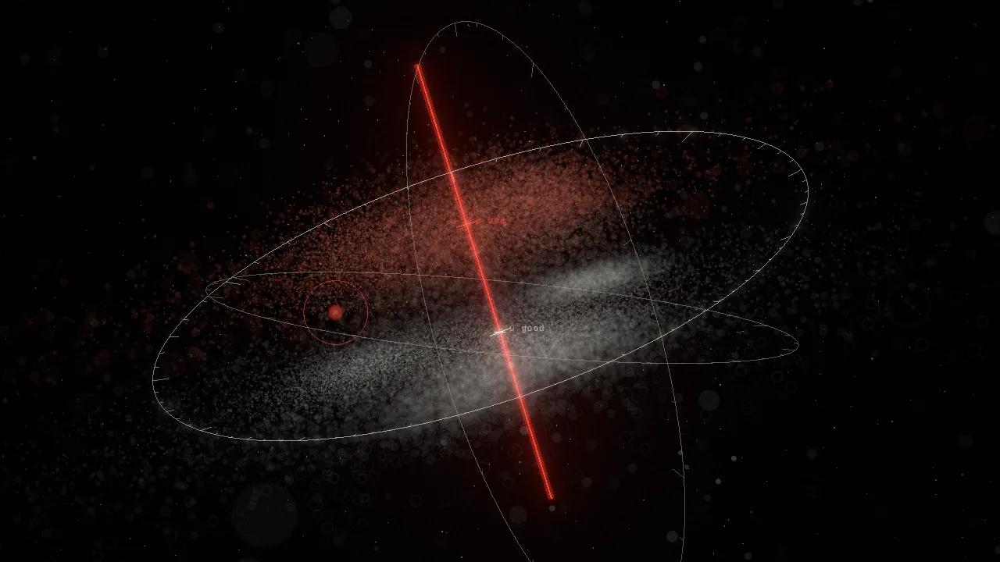
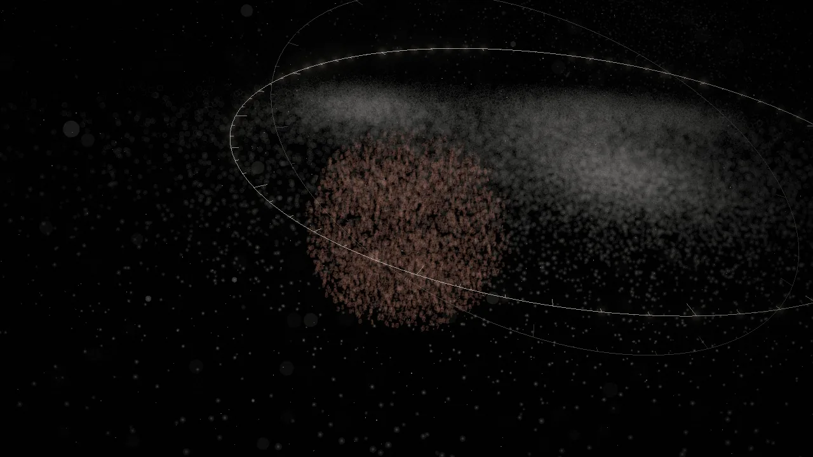

<p align="center">
  <a href="https://samuele95.github.io/schism/"></a>
</p>

<h1 align="center">S C H I S M</h1>

<p align="center"><i>σχίσμα — a cleft, a division</i></p>

<p align="center"><b>Decide what your model stops doing. Prove the rest held.</b></p>

<p align="center">
  <a href="https://samuele95.github.io/schism/">Watch the film</a> ·
  <a href="https://samuele95.github.io/schism/read/">Read the method</a> ·
  <a href="USAGE.md">Install and run</a> ·
  <a href="LICENSE">MIT</a>
</p>

---

**One set of weights. More than one personality.** *The flatterer. The rambler. The one that loops.*

Schism splits one of them off. Everything else is left as it was — and it proves both.

It is an agent skill for engineering a language model's behaviour, one behaviour at a time: slop, sycophancy, verbosity, humor, tone, looping. On open weights it operates on the matrices themselves. On a closed model no blade reaches the weights, so the incision is made in language: a prompt operator, measured on the geometry of its answers. It is not for training or fine-tuning.

There is nothing to compile. Schism is a method — fifteen technique cards, eight role prompts, a run protocol — that a capable LLM agent carries out itself. The agent implements each technique from its card, checks it against the card's self-check, and only then trusts it. What it has checked, it keeps for the next run.

<table>
  <tr>
    <td width="33%"></td>
    <td width="33%"></td>
    <td width="33%"></td>
  </tr>
  <tr>
    <td align="center"><sub>the weights are numbers</sub></td>
    <td align="center"><sub>II · Map — locate it</sub></td>
    <td align="center"><sub>V · Seal — opened once</sub></td>
  </tr>
</table>

## The operation

Five phases. Each one is a gate; nothing passes it on trust.

### I · Frame — *name the personality you want gone*

Show it, then show its absence. The behaviour becomes two observable conditions — what the answers look like with it, and without it — and two prompt sets that differ only there. Choosing the prompts *is* defining what will be cut, so the design is audited for confounds before anything runs. Then the prompts are split four ways — fit, probe, dev, vault — and the vault is sealed and hashed before anything is touched.

### II · Map — *locate it*

The Cartographer captures the residual stream at the decision token, reads the weights and the attention, and writes a hypothesis of where the behaviour lives, with its evidence. Then the feasibility gate: *switchable*, *diffuse*, *absent* or *inconclusive*. If it lives nowhere, the operation is called off and the record says why — a result, not a failure. Editing can remove an obstacle. It cannot add an ability that isn't there.

### III · Floor — *the standard procedure goes first*

The baseline pipeline (Arbitrary-Rank Ablation by default, or directional ablation) searched in full with multi-objective TPE. Its best trial is **candidate zero**, and it sets the mark. The tournament starts from it — so it can only match the floor, or go further.

### IV · Tournament — *sever one direction; nothing else*

An [Alchemist](#the-family) tournament, run once per preservation tier, loosest to tightest. The removal target is fixed by the floor, so each tighter tier buys preservation at equal removal.

- **The hand that cuts never sees a verdict.** The Smith (weights) or the operator compiler (closed models) proposes one candidate per call and receives only the next instruction — because a compiler that sees which test failed learns to satisfy the test.
- **Four examiners, kept apart.** Behaviour, preservation, capability, Goodhart. Each sees only its own slice of the evidence; the Goodhart tester sees all of it, and assumes gaming until the evidence says otherwise.
- **One judge.** The Arbiter reads every verdict and the whole history, never the raw answers, and orders one fix.

A proven barrier ends the ratchet, and is reported as the tightest tier that holds.

### V · Seal — *opened once*

Every candidate on the front is scored once on the vault and set head-to-head against the floor. Every number that chose a candidate flatters it; the vault chose nothing. A difference counts only when it clears the vault's sampling noise. If Schism only matches the floor, at a higher cost — that is the result, and it is reported.

## Two branches

| | Weights branch | Semantic branch |
|---|---|---|
| **For** | open-weight models, local or on a remote GPU | closed models, reached through an API or agent |
| **The edit** | a change to the matrices that write into the residual stream, stored as a LoRA adapter on a scratch copy | a prompt operator: system prompt, prefix or suffix |
| **Preservation** | first-token KL on neutral prompts (default tiers 0.40 · 0.20 · 0.10) | drift on neutral prompts, against the sampling noise floor (2.0× · 1.5× · 1.2×) |
| **How results are worded** | *this edited model* | *this model, with this operator* — never a changed model |

## What comes back

Every operation is on the record.

| Path | What it holds |
|---|---|
| `seal/report.md` | the outcome in its first sentence — chosen candidate, vault scores, against the floor — then the front, then what needs your attention |
| `exports/<candidate>/` | the edit, as merged weights or an adapter, always in a new folder — never the model's own |
| `ledger.md` | everything the run did, in order: phases, hypotheses, budgets, deviations, decisions |
| `seal/manifest.json` | what it takes to replay the run: brief, hashes, every front candidate's spec, environment |

## Ground rules

- **Nothing is overwritten.** Edits live beside the weights, in adapters, and come out clean. The original is the measure of everything.
- **Four disjoint splits, fixed at the start.** The vault is scored once, at the end, by the Seal alone.
- **Budgets are part of the experiment.** Forward passes, iterations, samples — all counted in the ledger. A result without its budget can't be read.
- **Implement, check, then trust.** A failed self-check stops that technique.
- **Every prompt goes through Prometheus.** A prompt written by hand inside a run is a defect — the measurement stimuli and the floor's own operator are the only exceptions.

## The family

| Skill | Owns |
|---|---|
| **Schism** | the method: technique cards, contrast design, the map, the gate, the floor, the vault, the front, the ledger, the export |
| **Alchemist** *(required)* | the search: compiler → isolated testers → judge with history, to convergence or a proven barrier |
| **[Prometheus](https://github.com/Samuele95/prometheus)** *(required)* | every prompt: rubrics, role prompts, operator candidates |
| **Weight Space Programming** *(optional)* | general weight reading and writing, when installed |

## Install and run

Place [`schism/`](schism/) in the skills folder your agent loads from, next to `alchemist/` and `prometheus/`. Then name the behaviour, the model, and how you're running it:

```text
Use Schism to reduce slop in Qwen3-4B-Instruct. I'm here, ask me if something is ambiguous.
```

```text
Use Schism on the semantic branch to make this model less sycophantic.
```

Unattended, overnight: copy [`schism/assets/run-brief.yaml`](schism/assets/run-brief.yaml), set `deployment: unattended` and `approved: true`, and point the agent at it. Without `approved: true`, Schism builds the tournament harness and stops after the floor: a live tournament spends tokens nobody approved.

**First run:** a calibration run on a small open model (about 1–2B parameters) with the slop preset. It checks the agent's implementations once; every later run on that machine reuses them.

Requirements, models and reasoning effort, and rough costs are in **[USAGE.md](USAGE.md)**.

## What Schism does not claim

Schism ships a method and its verifiers, not results. The skill was not run during its design, and nothing here reports a removal rate, a preservation score or a win over the baseline. [`delivery/EMPIRICAL-TEST.md`](delivery/EMPIRICAL-TEST.md) specifies how to find out: acceptance tests, then a head-to-head against the baseline pipeline on two behaviours and two model sizes — because one run is an anecdote. The cost figures in [USAGE.md](USAGE.md) are rough, not measured. The Weight Space Programming results quoted in the cards are a paper's early results on one model family (Takehi et al., 2026), not Schism's.

## In this repository

```text
schism/              the skill — install this folder
├── SKILL.md         the method: ground rules, doubt, the run, failure modes, report
├── references/      run protocol (phase by phase) and coordination (roles, contracts)
├── cards/           15 technique cards: stream, contrasts, directions, ablation, ARA,
│                    LoRA, meters, judges, TPE, floor and vault, locating, WSP, semantic branch
├── roles/           8 role prompts: Cartographer, Smith, operator compiler,
│                    four testers, Arbiter
└── assets/          run brief, Alchemist run config, ledger and report templates
USAGE.md             install, run, models, rough cost
delivery/            how the package was designed: Prometheus audit, verifier spec,
                     static and contract verifiers, empirical test plan
docs/                the built site, served by GitHub Pages
site/                the site's source
├── content/         what the site may say: brief (every claim, with its source),
│                    storyboard, lore, design system, reading-room plan
├── chain/           the five-stage Prometheus chain that designed and built it
├── src/, scripts/   three.js film, reading-room generator
└── tools/           headless capture and checks
```

## The site

[samuele95.github.io/schism](https://samuele95.github.io/schism/) is a single continuous take, scrubbed by scroll: code rain condensing into a weight matrix, the matrix lifting into an activation space, a search, a cut, a held moment, a collapse, a seal broken once. Every line on screen carries the id of the claim it rests on (`site/content/brief.md`), and the reading room renders this repository's own files as they are. With reduced motion or without WebGL, the film becomes a sequence of stills with all of its text.

```bash
cd site
npm ci
npm run dev     # local preview; add ?debug for frame time
npm run build   # regenerates the reading room and writes docs/
```

## Licence

[MIT](LICENSE) © 2026 Samuele Stronati
