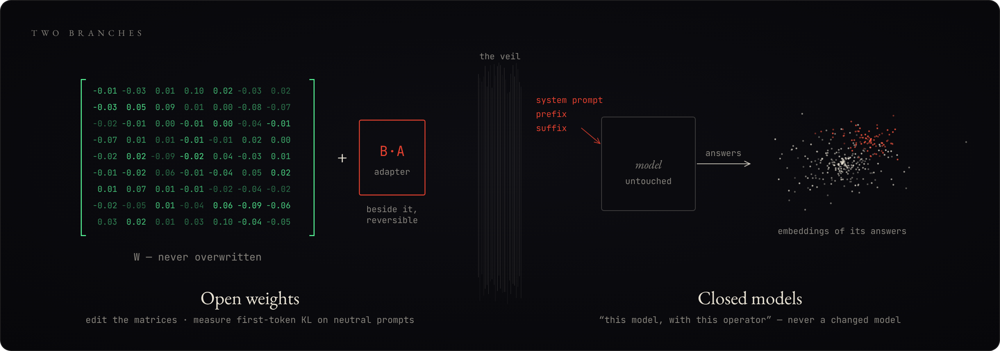

<p align="center">
  <a href="https://samuele95.github.io/schism/"></a>
</p>

<p align="center">
  <a href="LICENSE"></a>
  <a href="https://github.com/Samuele95/schism/releases"></a>
  <a href="https://samuele95.github.io/schism/"></a>
  <a href="schism/SKILL.md"></a>
  <a href="CITATION.cff"></a>
</p>

<p align="center">
  <a href="https://samuele95.github.io/schism/"><b>Watch the film</b></a> &nbsp;·&nbsp;
  <a href="https://samuele95.github.io/schism/read/">Read the method</a> &nbsp;·&nbsp;
  <a href="USAGE.md">Install and run</a> &nbsp;·&nbsp;
  <a href="CHANGELOG.md">Changelog</a>
</p>

<br>

A language model is one set of weights with more than one personality in it: the one that answers your question, the one that flatters you while it does, the one that rambles, the one that pads every reply with the same tired phrases. **Schism** is an agent skill for taking hold of one of those personalities and changing it on purpose, by intervening in the model's weight space and on the representations inside it. It can sever a behaviour, turn it down, or make the default one the model shows only when asked, and every time it has to earn a claim with two halves: *this behaviour changed as intended*, and *nothing else moved*.

There is nothing to compile. Schism is a method, written as a run protocol, fifteen technique cards and eight role prompts, that a capable LLM agent carries out itself: it implements each technique from its card, checks the implementation against the card's own self-check, and only then lets it touch a model.

<table>
<tr><td width="33%" valign="top">

**What it is for**

LLM ablation in the abliteration tradition, customising a model without a fine-tuning dataset, and enforcing a register, a format or a style the model already knows how to produce.

</td><td width="33%" valign="top">

**Where it works**

On open weights, as an edit to the matrices kept in a LoRA adapter. On closed models, as a prompt operator whose effect is measured on the geometry of the answers.

</td><td width="33%" valign="top">

**What it proves**

That the behaviour moved, on a sealed vault scored once, and that the rest of the model held, against preservation thresholds and the standard procedure as a floor.

</td></tr>
</table>

**Contents** &nbsp; [Three operations](#three-operations-one-contrast) · [The operation](#the-operation) · [The cut](#the-cut) · [The tournament](#the-tournament) · [Two branches](#two-branches) · [What comes back](#what-comes-back) · [The family](#the-family) · [Quick start](#quick-start) · [Limits](#what-it-does-not-claim) · [Repository](#inside-the-repository) · [Acknowledgements](#acknowledgements)

## Three operations, one contrast

<p align="center"></p>

Every run is built on one contrast pair, two sets of prompts that differ only in the behaviour. The pair is symmetric, with one side the edit moves the model away from and one it moves it toward, so what a run does depends only on which side holds the model's default.

| Operation | The contrast | What changes in the model |
|---|---|---|
| **Ablate** | the behaviour the model shows, against its absence | outputs on prompts that show the behaviour are moved to where its absence is |
| **Tune** | either reading of the pair | the strength of the edit, a parameter of every technique, set within the preservation tiers; the front shows what each strength costs |
| **Inject** | the model's uninstructed default, against the behaviour it shows when instructed | the default outputs are moved to where the instructed ones are, so the instructed behaviour becomes the uninstructed one |

Two limits keep these words honest. An edit can make a model do by default what it already does on request, but it cannot give it a behaviour it never produces, and the feasibility gate checks this before anything is cut. And Schism changes how a model behaves, not what it knows, so facts and knowledge are outside it. No fine-tuning dataset is involved either: on open weights every edit is computed from two sets of prompts and the model's own activations, on closed models from sampled answers, although the default edit still fits its adapter by optimisation.

## The operation

<p align="center"></p>

A run is a sequence of five phases, and each one is a gate.

| | Phase | What happens | The gate |
|---|---|---|---|
| I | **Frame** | the behaviour becomes something measurable: both sides in one sentence each, the two prompt sets that differ only there, four disjoint splits | the design is audited for confounds, and the vault is sealed and hashed before any edit exists |
| II | **Map** | the Cartographer reads the residual stream at the model's first word, and the weights and attention that write into it | if the behaviour lives nowhere in particular, the operation is called off with the reason on the record |
| III | **Floor** | the standard procedure, done properly: ARA by default, or classic directional ablation, searched with multi-objective TPE | its best result becomes candidate zero, the mark everything after it has to match or beat |
| IV | **Tournament** | the cut is refined under the rules [below](#the-tournament), one round per preservation threshold | every candidate is examined by four isolated testers and a judge |
| V | **Seal** | the vault is opened: every surviving candidate is scored on it once and set head-to-head against the floor | a difference counts only when it clears the vault's own sampling noise |

The vault matters because a number used to choose a candidate always flatters it, and the vault chose nothing. If all Schism manages is to match the floor at a higher cost, the report says so.

## The cut

<p align="center"></p>

The simplest edit shows the idea most clearly. Capture what the model is about to say for prompts with the behaviour and without it, and the two clouds sit apart, the answers with the behaviour displaced along one direction, the difference between the two means. Directional ablation removes that component from what the edited layers write and leaves every other direction as it was, so in its plain form the plume falls back into the disc while the disc stays where it was. With a strength below one it only weakens the component, which is how it tunes, and an injection run uses the same cut with the default on the side being removed.

The original weights are never overwritten: the edit lives beside them in an adapter, and the untouched model stays the reference every number is measured against. Most behaviours are less tidy than one direction, which is why the default edit, ARA, assumes no single direction and pulls each layer's outputs toward real examples of the target, and why the cards also cover narrower surgery on individual neurons and attention heads.

## The tournament

<p align="center"></p>

The search for the cut is a tournament run by [Alchemist](#the-family), once for each preservation threshold, from the loosest to the tightest. The target for the behaviour stays fixed at what the floor achieved, so every tighter round buys preservation instead of trading it away. Its rules are about who may see what:

- **The hand that cuts** (the Smith on open weights, the operator compiler on closed models) proposes one candidate per call and never sees a verdict, only the single fix the judge sends back, because a compiler that knows which test failed learns to satisfy the test instead of the goal.
- **Four examiners** each check one thing on their own slice of the evidence: whether the behaviour changed, whether everything else stayed put, whether the model can still do real work, and whether any of it was gamed. The last one sees everything and assumes gaming until the evidence says otherwise.
- **The judge** reads every verdict and the whole history, never the raw answers, and names one fix.

When two requirements cannot hold together, the tournament proves it and stops, and that boundary is reported as the tightest threshold the model allows.

## Two branches

<p align="center"></p>

| | Open weights | Closed models |
|---|---|---|
| **The edit** | a change to the matrices that write into the residual stream, computed from the model's internal representations | a system prompt, prefix or suffix written by the run's prompt compiler |
| **Where it lives** | a LoRA adapter on a scratch copy, never over the original | in front of the model; nothing reaches the weights |
| **Preservation** | how far the edit moves the model's first word on prompts unrelated to the behaviour | drift of the answers' embeddings, against how much two unedited samples already differ |
| **The result** | a changed model, exported as an adapter or as merged weights | *this model, with this operator*, because the model itself is never changed |

## What comes back

Every operation is on the record. A run leaves a report whose first sentence is the outcome, naming the chosen candidate, its scores on the vault and how it compares with the floor, followed by the full front of candidates and anything that needs your attention. The chosen edit is exported to a new folder, as merged weights or as an adapter, and beside it sit the ledger, an append-only account of everything the run did in the order it did it, and a manifest with what anyone needs to replay it.

## The family

| | Owns | Status |
|---|---|---|
| **Schism** | the method: the cards, the contrast design, the map and its gate, the floor, the vault, the ledger | this repository |
| **Alchemist** | the search: a compiler, isolated testers and a judge with memory, until the candidates converge or a barrier is proven | required |
| **A prompt compiler** | every prompt the run uses, from the judges' rubrics to the operators on closed models | required; [**Prometheus**](https://samuele95.github.io/prometheus/) recommended |
| **Weight Space Programming** | general reading and writing of weights | optional |

Schism defines the prompt compiler by what it does rather than what it is: any map from a prompt to a prompt, whether a meta-prompting skill such as Prometheus, a plain call to an LLM asking for that kind of prompt, or anything else that turns prompt text into prompt text. The brief names it and every call is kept, so on closed models the tournament simply iterates it, each new operator being the compiler applied to the last one and the judge's fixes. A prompt written inline inside a run, outside a recorded compiler call, is treated as a defect.

## Quick start

1. Place [`schism/`](schism/) in the skills folder your agent loads from, next to `alchemist/`.
2. Choose a prompt compiler: `prometheus/` if you have it, otherwise a plain LLM call.
3. Tell the agent what to change, in which model, and whether you will be there to answer questions:

```text
Use Schism to reduce slop in Qwen3-4B-Instruct. I'm here, ask me if something is ambiguous.

Use Schism to make Qwen3-4B-Instruct answer in plain, terse English by default, the way it does when I ask for it.

Use Schism on the semantic branch to make this model less sycophantic.
```

With you present, Schism asks at three moments only: to confirm the brief, to settle borderline examples for the judges, and to let you choose from the final candidates.

> [!TIP]
> Make the first run a calibration run on a small open model, around one or two billion parameters, with the slop preset. It checks the agent's implementations once, and every later run on the same machine inherits them.

To run it overnight, copy [`schism/assets/run-brief.yaml`](schism/assets/run-brief.yaml), set `deployment: unattended` and `approved: true`, and point the agent at it; without that approval it builds the whole harness and stops before spending anything on a live tournament. Requirements, model choices and rough costs are in [**USAGE.md**](USAGE.md).

## What it does not claim

> [!IMPORTANT]
> Schism ships a method and the means to check it, not results. The skill was not run while it was being designed, and nothing here reports a removal rate, a preservation score or a win over the standard procedure.

[`delivery/EMPIRICAL-TEST.md`](delivery/EMPIRICAL-TEST.md) describes how to find out honestly, with acceptance tests first and then a head-to-head against the baseline on two behaviours and two model sizes, because a single run is an anecdote. The cost figures in the usage notes are estimates, and the results from the Weight Space Programming paper that the cards cite (Takehi et al., 2026) are that paper's early findings on one model family, not Schism's.

## Inside the repository

| Path | What it holds |
|---|---|
| [`schism/`](schism/) | the skill: `SKILL.md` with the method and its ground rules, the run protocol and coordination contracts in `references/`, fifteen technique cards in `cards/`, eight role prompts in `roles/`, run templates in `assets/` |
| [`USAGE.md`](USAGE.md) | installation, requirements, models and rough costs |
| [`delivery/`](delivery/) | how the package was designed: the design audit, the verifier specification, two verifier prompts and the empirical test plan |
| [`site/`](site/) → [`docs/`](docs/) | the website's source and its build, served by GitHub Pages |
| [`assets/`](assets/) | the banner and figures, drawn by [`assets/src/figures.py`](assets/src/figures.py) |

The website is a single continuous take, scrubbed by scroll and built with three.js, and every factual sentence on it carries the id of the claim it rests on in [`site/content/brief.md`](site/content/brief.md). Its reading room renders this repository's own files as they are, and visitors without WebGL, or who prefer reduced motion, get the same story as a sequence of stills. To work on it, run `npm ci` and `npm run dev` inside `site/`; `npm run build` regenerates the reading room and writes `docs/`. [`CONTRIBUTING.md`](CONTRIBUTING.md) says how changes to the cards and the site are checked.

## Acknowledgements

Schism stands on [**Heretic**](https://github.com/p-e-w/heretic) by **Philipp Emanuel Weidmann** ([@p-e-w](https://github.com/p-e-w)). Arbitrary-Rank Ablation, the default edit in Schism's floor and tournament, is his method, developed for Heretic and introduced there in 2026. Heretic is also the reference for the floor as a whole: directional ablation applied through LoRA adapters, response prefixes for reasoning models, and a TPE search that trades a keyword rate against KL divergence. Schism re-describes these techniques as cards for an agent to implement and check, and contains none of Heretic's code, which is released under the AGPL-3.0.

The idea of reading and writing weights directly, and the limits Schism keeps as rules, come from the Weight Space Programming paper (Takehi et al., 2026).

## Licence and citation

Released under the [MIT licence](LICENSE), © 2026 Samuele Stronati. If you use Schism in your work, cite it through [`CITATION.cff`](CITATION.cff), or with the "Cite this repository" button on GitHub.
