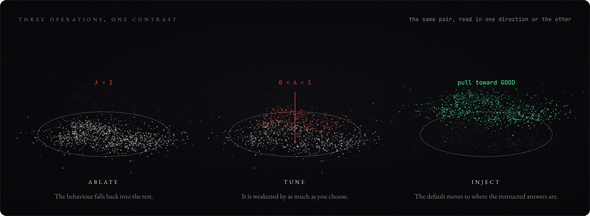
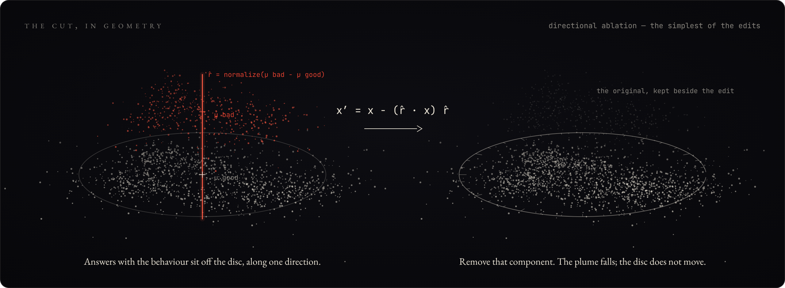

<p align="center">
  <a href="https://samuele95.github.io/schism/"></a>
</p>

<p align="center">
  <a href="LICENSE"></a>
  <a href="https://github.com/Samuele95/schism/releases"></a>
  <a href="https://samuele95.github.io/schism/"></a>
  <a href="schism/SKILL.md"></a>
</p>

<p align="center">
  <a href="https://samuele95.github.io/schism/"><b>Watch the film</b></a> &nbsp;·&nbsp;
  <a href="https://samuele95.github.io/schism/read/">Read the method</a> &nbsp;·&nbsp;
  <a href="USAGE.md">Install and run</a> &nbsp;·&nbsp;
  <a href="CHANGELOG.md">Changelog</a>
</p>

<br>

A language model is one set of weights with more than one personality in it: the one that answers your question, the one that flatters you while it does, the one that rambles, the one that pads every reply with the same tired phrases. Schism is an agent skill for taking hold of one of those personalities and changing it on purpose. It can sever it, turn it down, or make the model's default a behaviour it shows only when asked, and it does so by intervening in the model's weight space and on the representations inside it. Whatever it does, it has to earn a claim with two halves: *this behaviour changed as intended*, and *nothing else moved*.

That makes it useful for LLM ablation in the abliteration tradition, for customising a model without a fine-tuning dataset, and for enforcing a register, a format or a style that the model already knows how to produce. When the weights are open, Schism edits the matrices themselves. When they are not, it works in language instead, with a prompt operator whose effect is measured on the geometry of the model's answers.

There is nothing to compile. Schism is written as a method, made of a run protocol, fifteen technique cards and eight role prompts, for a capable LLM agent to carry out itself: the agent implements each technique from its card, checks the implementation against the card's own self-check, and only then lets it touch a model, keeping what it has checked for every later run.

## Three operations, one contrast

<p align="center"></p>

Every run is built on one contrast pair, two sets of prompts that differ only in the behaviour, and the pair is symmetric: one side is where the edit moves the model away from, the other where it moves it toward. What the run does depends only on which side holds the model's default.

| Operation | The contrast | What changes in the model |
|---|---|---|
| **Ablate** | the behaviour the model shows, against its absence | outputs on prompts that show the behaviour are moved to where its absence is |
| **Tune** | either reading of the pair | the strength of the edit is a parameter of every technique; the preservation tiers bound it, and the front shows what each strength costs |
| **Inject** | the model's uninstructed default, against the behaviour it shows when instructed | the default outputs are moved to where the instructed ones are, so the instructed behaviour becomes the uninstructed one |

Two limits keep these words honest. An edit can make a model do by default what it already does on request, but it cannot give it a behaviour it never produces, and the feasibility gate checks this before anything is cut. And Schism changes how a model behaves, not what it knows: facts and knowledge are outside it. No fine-tuning dataset is involved: on open weights every edit is computed from two sets of prompts and the model's own activations, on closed models from sampled answers, although the default edit still fits its adapter by optimisation.

## The operation

<p align="center"></p>

A run is a sequence of five phases, and each one is a gate.

It begins with **Frame**, where the behaviour stops being a word and becomes something you can measure. You name the personality you want gone, or the one you want in its place, and describe both sides in one sentence each; then you choose the two sets of prompts that differ only there, which is the moment the behaviour is really defined, so the design is audited for confounds before anything runs. The prompts are divided into four disjoint splits, and one of them, the vault, is sealed and hashed before any edit exists.

**Map** asks where the behaviour lives. The Cartographer reads the residual stream at the moment the model is about to give its first word, reads the weights and the attention that write into it, and returns a hypothesis with its evidence. A feasibility gate follows: if the behaviour can be switched, the run goes on, and if it lives nowhere in particular the operation is called off with the reason on the record, because an edit can remove an obstacle but cannot give a model an ability it never had.

**Floor** is the standard procedure, done properly. The baseline pipeline, Arbitrary-Rank Ablation by default (the method Philipp Emanuel Weidmann developed for [Heretic](https://github.com/p-e-w/heretic)) or classic directional ablation, is searched with multi-objective TPE over the standard meters, and its best result becomes candidate zero. Everything after it starts from that mark, so Schism can match the standard procedure or go further, never fall below it.

**Tournament** refines the cut under the rules set out in [the tournament](#the-tournament). **Seal** finally opens the vault: every surviving candidate is scored on it exactly once and set head-to-head against the floor. A number used to choose a candidate always flatters it, and the vault chose nothing, which is why its verdict is the one that counts. A difference is called real only when it clears the vault's own sampling noise, and if all Schism manages is to match the floor at a higher cost, the report says so.

## The cut

<p align="center"></p>

The simplest edit shows the idea most clearly. Capture what the model is about to say for prompts with the behaviour and without it, and the two clouds sit apart, the answers with the behaviour displaced along one direction, the difference between the two means. Directional ablation removes that component from what the edited layers write and leaves every other direction as it was, so in its plain form every point keeps its other coordinates and the plume falls back into the disc while the disc stays where it was. With a strength below one it only weakens the component, which is how it tunes, and an injection run uses the same cut with the default on the side being removed, which is how it makes the instructed behaviour the default.

The original weights are never overwritten. The edit lives beside them in an adapter, and the untouched model remains the reference every number is measured against. Most behaviours are less tidy than one direction, which is why the default edit, ARA, assumes no single direction at all and pulls each layer's outputs toward real examples of the target, and why the cards also cover narrower surgery on individual neurons and attention heads. The question is always the one in the figure: what moved, and what didn't.

## The tournament

<p align="center"></p>

The search for the cut is a tournament run by [Alchemist](#the-family), once for each preservation threshold, from the loosest to the tightest. The target for the behaviour stays fixed at what the floor achieved, so every tighter round is spent buying preservation rather than trading it away.

Its rules are about who is allowed to see what. The hand that cuts, the Smith on open weights and the operator compiler on closed models, proposes one candidate per call and never sees a verdict, only the single fix the judge sends back, because a compiler that knows which test failed learns to satisfy the test instead of the goal. Four examiners each check one thing and see only their own slice of the evidence: whether the behaviour changed, whether everything else stayed put, whether the model can still do real work, and whether any of it was gamed. That last examiner sees everything and assumes gaming until the evidence says otherwise. Above them a judge reads every verdict and the whole history, never the raw answers, and names one fix. When two requirements cannot hold together, the tournament proves it and stops, and that boundary is reported as the tightest threshold the model allows.

## Two branches

<p align="center"></p>

On **open weights** the edit is a change to the matrices that write into the residual stream, computed from the model's internal representations and stored as a LoRA adapter on a scratch copy, and preservation is measured as how far the edit moves the model's first word on prompts that have nothing to do with the behaviour. On **closed models** nothing reaches the weights, so the change is made in language: a system prompt, prefix or suffix written by the run's prompt compiler and measured on the embeddings of the answers it produces, against how much two unedited samples already differ. A result on that side is always worded as *this model, with this operator*, because the model itself is never changed.

## What comes back

Every operation is on the record. A run leaves a report whose first sentence is the outcome, naming the chosen candidate, its scores on the vault and how it compares with the floor, followed by the full front of candidates and anything that needs your attention. The chosen edit is exported to a new folder, as merged weights or as an adapter, never into the model's own, and beside it sit the ledger, an append-only account of everything the run did in the order it did it, and a manifest with what anyone needs to replay it.

## The family

Schism owns the method: the cards, the contrast design, the map and its gate, the floor, the vault, the ledger. It relies on two collaborators for the rest. **Alchemist** runs the search, with a compiler, isolated testers and a judge with memory, until the candidates converge or a barrier is proven. A **prompt compiler** writes every prompt the run uses, from the judges' rubrics to the operators on the closed-model side, and Schism defines it by what it does rather than what it is: any map from a prompt to a prompt. It can be a meta-prompting skill such as [**Prometheus**](https://samuele95.github.io/prometheus/), the recommended one, a plain call to an LLM asking for that kind of prompt, or anything else that turns prompt text into prompt text. The brief names it and every call is kept, so on the closed-model side the tournament simply iterates it, each new operator being the compiler applied to the last one and the judge's fixes. A prompt written inline inside a run, outside a recorded compiler call, is treated as a defect. **Weight Space Programming**, when it is installed, takes over general reading and writing of weights.

## Quick start

Place [`schism/`](schism/) in the skills folder your agent loads from, next to `alchemist/`, and choose a prompt compiler: `prometheus/` if you have it, otherwise a plain LLM call. Then tell the agent what to change, in which model, and whether you will be there to answer questions:

```text
Use Schism to reduce slop in Qwen3-4B-Instruct. I'm here, ask me if something is ambiguous.
```

```text
Use Schism to make Qwen3-4B-Instruct answer in plain, terse English by default, the way it does when I ask for it.
```

```text
Use Schism on the semantic branch to make this model less sycophantic.
```

With you present, Schism asks at three moments only: to confirm the brief, to settle borderline examples for the judges, and to let you choose from the final candidates. To run it overnight instead, copy [`schism/assets/run-brief.yaml`](schism/assets/run-brief.yaml), set `deployment: unattended` and `approved: true`, and point the agent at it; without that approval it builds the whole harness and stops before spending anything on a live tournament.

Make the first run a calibration run on a small open model, around one or two billion parameters, with the slop preset. It checks the agent's implementations once, and every later run on the same machine inherits them. Requirements, model choices and rough costs are in [**USAGE.md**](USAGE.md).

## What it does not claim

Schism ships a method and the means to check it, not results. The skill was not run while it was being designed, and nothing here reports a removal rate, a preservation score or a win over the standard procedure. [`delivery/EMPIRICAL-TEST.md`](delivery/EMPIRICAL-TEST.md) describes how to find out honestly, with acceptance tests first and then a head-to-head against the baseline on two behaviours and two model sizes, because a single run is an anecdote. The cost figures in the usage notes are estimates, and the results from the Weight Space Programming paper that the cards cite (Takehi et al., 2026) are that paper's early findings on one model family, not Schism's.

## Inside the repository

| Path | What it holds |
|---|---|
| [`schism/`](schism/) | the skill: `SKILL.md` with the method and its ground rules, the run protocol and coordination contracts in `references/`, fifteen technique cards in `cards/`, eight role prompts in `roles/`, run templates in `assets/` |
| [`USAGE.md`](USAGE.md) | installation, requirements, models and rough costs |
| [`delivery/`](delivery/) | how the package was designed: the design audit, the verifier specification, two verifier prompts and the empirical test plan |
| [`site/`](site/) → [`docs/`](docs/) | the website's source and its build, served by GitHub Pages |
| [`assets/`](assets/) | the banner and figures, drawn by [`assets/src/figures.py`](assets/src/figures.py) |

The website is a single continuous take, scrubbed by scroll and built with three.js, and every factual sentence on it carries the id of the claim it rests on in [`site/content/brief.md`](site/content/brief.md). Its reading room renders this repository's own files as they are, and visitors without WebGL, or who prefer reduced motion, get the same story as a sequence of stills. To work on it, run `npm ci` and `npm run dev` inside `site/`; `npm run build` regenerates the reading room and writes `docs/`. [`CONTRIBUTING.md`](CONTRIBUTING.md) says how changes to the cards and the site are checked.

## Acknowledgements

Schism stands on [**Heretic**](https://github.com/p-e-w/heretic) by **Philipp Emanuel Weidmann** ([@p-e-w](https://github.com/p-e-w)). Arbitrary-Rank Ablation, the default edit in Schism's floor and tournament, is his method, developed for Heretic and introduced there in 2026. Heretic is also the reference for the floor as a whole: directional ablation applied through LoRA adapters, response prefixes for reasoning models, and a TPE search that trades a keyword rate against KL divergence. Schism re-describes these techniques as cards for an agent to implement and check, and contains none of Heretic's code, which is released under the AGPL-3.0.

The idea of reading and writing weights directly, and the limits Schism keeps as rules, come from the Weight Space Programming paper (Takehi et al., 2026).

## Licence and citation

Released under the [MIT licence](LICENSE), © 2026 Samuele Stronati. If you use Schism in your work, cite it through [`CITATION.cff`](CITATION.cff), or with the "Cite this repository" button on GitHub.
