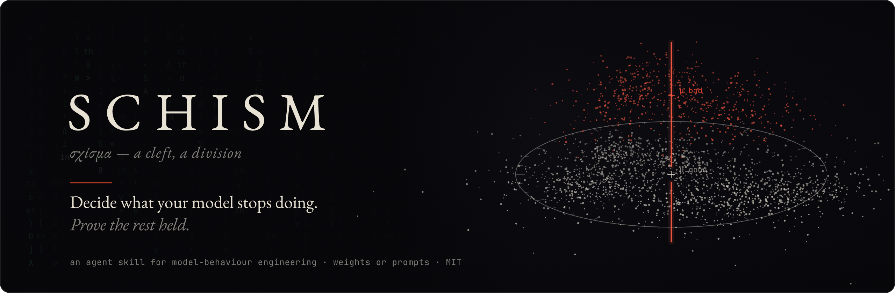
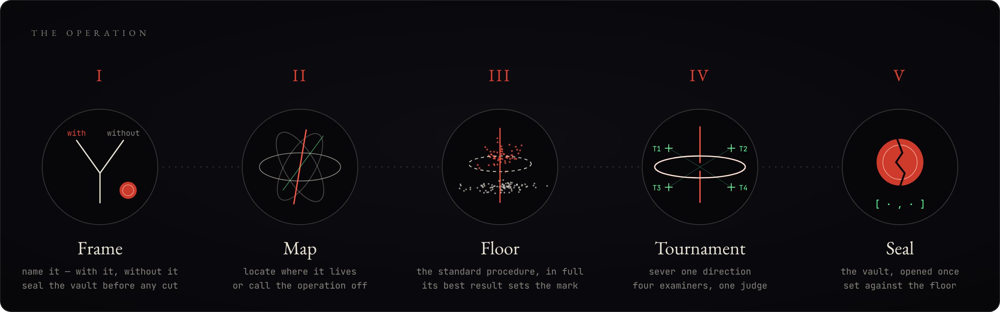
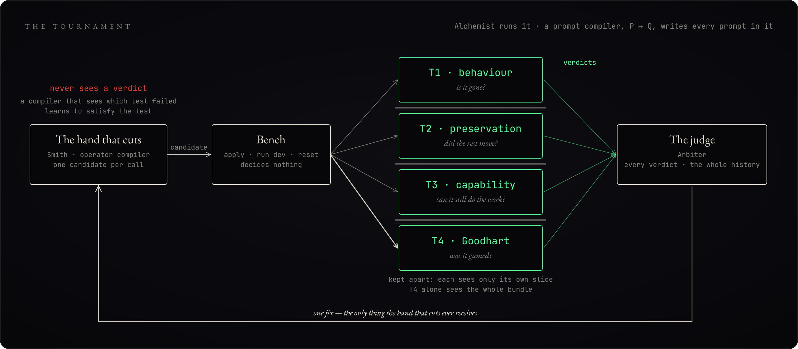

<p align="center">
  <a href="https://samuele95.github.io/schism/"></a>
</p>

<p align="center">
  <a href="https://samuele95.github.io/schism/"><b>Watch the film</b></a> &nbsp;·&nbsp;
  <a href="https://samuele95.github.io/schism/read/">Read the method</a> &nbsp;·&nbsp;
  <a href="USAGE.md">Install and run</a> &nbsp;·&nbsp;
  <a href="LICENSE">MIT</a>
</p>

<br>

A language model is one set of weights with more than one personality in it. There is the one that answers your question, and there is the one that flatters you while it does. There is the one that rambles, the one that pads every reply with the same tired phrases, the one that gets caught in a loop and cannot find its way out.

Schism is an agent skill for separating one of those personalities from the rest — and for proving, afterwards, that the separation was clean. It works one behaviour at a time: slop, sycophancy, verbosity, humor, tone, looping. When the weights are open, it operates on the matrices themselves. When they are not, it makes the incision in language instead, with a prompt operator whose effect is measured on the geometry of the model's answers. Either way the claim it has to earn has two halves: *this behaviour is gone*, and *nothing else moved*.

There is nothing to compile. Schism is written as a method — a run protocol, fifteen technique cards, eight role prompts — for a capable LLM agent to carry out itself. The agent implements each technique from its card, checks the implementation against the card's own self-check, and only then lets it touch a model. What it has checked once, it keeps for every later run.

## The operation

<p align="center"></p>

A run is a sequence of five phases, and each one is a gate.

It begins with **Frame**, where the behaviour stops being a word and becomes something you can measure. You name the personality you want gone, then show it, and show its absence: two observable conditions, one sentence each, and two sets of prompts that differ only there. Choosing those prompts is defining what will be cut, so the design is audited for confounds before anything runs. The prompts are then divided into four disjoint splits, and one of them — the vault — is sealed and hashed before any edit exists.

**Map** asks where the behaviour lives. The Cartographer reads the residual stream at the moment the model is about to give its first word, reads the weights and the attention that write into it, and returns a hypothesis with its evidence. Then comes the feasibility gate. If the behaviour can be switched off, the run goes on. If it lives nowhere in particular, the operation is called off and the record says why — because editing can remove an obstacle, but it cannot give a model an ability it never had.

**Floor** is the standard procedure, done properly: the baseline pipeline — Arbitrary-Rank Ablation by default, the method Philipp Emanuel Weidmann developed for [Heretic](https://github.com/p-e-w/heretic), or classic directional ablation — searched in full. Its best result becomes candidate zero, and candidate zero sets the mark. Everything after it starts from there, so Schism can only match the standard procedure or go further — never fall below it.

**Tournament** is where the cut is refined, and it is described below. **Seal** is where the vault is finally opened: every surviving candidate is scored on it exactly once and set head-to-head against the floor. A number used to choose a candidate always flatters it; the vault chose nothing, which is why its verdict is the one that counts. A difference is called real only when it clears the vault's own sampling noise, and if all Schism manages is to match the floor at a higher cost, then that is the result, and the report says so.

## The cut

<p align="center"></p>

The simplest of the edits shows the idea most clearly. Capture what the model is about to say, for prompts with the behaviour and without it, and the two clouds sit apart: the answers with the behaviour are displaced along one direction, the difference between the two means. Directional ablation removes exactly that component from what the model writes, and nothing else. Every point keeps its other coordinates, so the plume falls back into the disc while the disc stays where it was. The original weights are never overwritten: the edit lives beside them, in an adapter, and the untouched model remains the reference every number is measured against.

Most behaviours are not that tidy, which is why the default edit, ARA, assumes no single direction at all, and why the cards also cover narrower surgery on individual neurons and attention heads. But the question is always the one in the figure: what moved, and what didn't.

## The tournament

<p align="center"></p>

The search for the cut is a tournament run by [Alchemist](#the-family), once for each preservation threshold, from the loosest to the tightest. The removal target stays fixed at what the floor achieved, so every tighter round is spent buying preservation, not trading it away.

Its rules are about who is allowed to see what. The hand that cuts — the Smith on open weights, the operator compiler on closed models — proposes one candidate per call and never sees a verdict, only the single fix the judge sends back, because a compiler that knows which test failed learns to satisfy the test instead of the goal. Four examiners each check one thing and see only their own slice of the evidence: whether the behaviour is gone, whether everything else stayed put, whether the model can still do real work, and whether any of it was gamed. That last examiner sees everything, and assumes gaming until the evidence says otherwise. Above them sits a judge who reads every verdict and the whole history, never the raw answers, and names one fix. When two requirements cannot hold together, the tournament proves it and stops, and that boundary is reported as the tightest threshold the model allows.

## Two branches

<p align="center"></p>

On **open weights** the edit is a change to the matrices that write into the residual stream, stored as a LoRA adapter on a scratch copy, and preservation is measured as how far the edit moves the model's first word on prompts that have nothing to do with the behaviour. On **closed models** no blade reaches the weights, so the incision is made in language: a system prompt, prefix or suffix, designed through Prometheus and measured on the embeddings of the answers it produces, against how much two unedited samples already differ. A result on that side is always worded as *this model, with this operator*. The model itself is never changed, and Schism never says it was.

## What comes back

Every operation is on the record. A run leaves a report whose first sentence is the outcome — the chosen candidate, its scores on the vault, and how it compares with the floor — followed by the full front of candidates and anything that needs your attention. The chosen edit is exported to a new folder, as merged weights or as an adapter, never into the model's own. Alongside it sit the ledger, an append-only account of everything the run did in the order it did it, and a manifest with what anyone needs to replay it.

## The family

Schism owns the method: the cards, the contrast design, the map and its gate, the floor, the vault, the ledger. It leans on two siblings for the rest. **Alchemist** runs the search — compiler, isolated testers, a judge with memory — until the candidates converge or a barrier is proven. A **prompt compiler** writes every prompt the run uses, from the judges' rubrics to the operators on the closed-model side. Schism defines it by what it does rather than what it is: any map from a prompt to a prompt. It can be a meta-prompting skill such as **[Prometheus](https://samuele95.github.io/prometheus/)**, the recommended one, a plain call to an LLM asking for that kind of prompt, or anything else that turns prompt text into prompt text; the brief names it, and every call is kept on the record. On the closed-model side the tournament simply iterates it — each new operator is the compiler applied to the last one and the judge's fixes. A prompt written inline inside a run, outside a recorded compiler call, is treated as a defect, with the measurement prompts and the floor's own operator the only exceptions. **Weight Space Programming**, when it is installed, takes over general reading and writing of weights.

## Running it

Install by placing [`schism/`](schism/) in the skills folder your agent loads from, next to `alchemist/`, and choose a prompt compiler — `prometheus/` if you have it, otherwise a plain LLM call. Then tell the agent what you want gone, from which model, and whether you will be there to answer questions:

```text
Use Schism to reduce slop in Qwen3-4B-Instruct. I'm here, ask me if something is ambiguous.
```

```text
Use Schism on the semantic branch to make this model less sycophantic.
```

With you present, Schism asks at three moments only: to confirm the brief, to settle borderline examples for the judges, and to let you choose from the final candidates. To run it overnight instead, copy [`schism/assets/run-brief.yaml`](schism/assets/run-brief.yaml), set `deployment: unattended` and `approved: true`, and point the agent at it; without that approval it builds the whole harness and stops before spending anything on a live tournament.

Make the first run a calibration run on a small open model, around one or two billion parameters, with the slop preset. It checks the agent's implementations once, and every run after it on the same machine inherits them. Requirements, model choices and rough costs are in **[USAGE.md](USAGE.md)**.

## What it does not claim

Schism ships a method and the means to check it, not results. The skill was not run while it was being designed, and nothing here reports a removal rate, a preservation score, or a win over the standard procedure. [`delivery/EMPIRICAL-TEST.md`](delivery/EMPIRICAL-TEST.md) describes how to find out honestly: acceptance tests first, then a head-to-head against the baseline on two behaviours and two model sizes, because a single run is an anecdote. The cost figures in the usage notes are estimates. The results from the Weight Space Programming paper that the cards cite (Takehi et al., 2026) are that paper's early findings on one model family, not Schism's.

## Inside the repository

[`schism/`](schism/) is the skill itself: `SKILL.md` with the method and its ground rules, the run protocol and coordination contracts in `references/`, the fifteen technique cards in `cards/`, the eight role prompts in `roles/`, and run templates in `assets/`. [`USAGE.md`](USAGE.md) covers installation and running, and [`delivery/`](delivery/) records how the package was designed: the Prometheus audit, the verifier specification, two verifier prompts and the empirical test plan.

The website lives in [`docs/`](docs/) and is served by GitHub Pages; its source is in [`site/`](site/). It is a single continuous take, scrubbed by scroll and built with three.js, and every sentence on it carries the id of the claim it rests on in [`site/content/brief.md`](site/content/brief.md). Its reading room renders this repository's own files as they are, and visitors without WebGL, or who prefer reduced motion, get the same story as a sequence of stills. To work on it, run `npm ci` and `npm run dev` inside `site/`; `npm run build` regenerates the reading room and writes `docs/`. The figures in this README are drawn by [`assets/src/figures.py`](assets/src/figures.py).

## Acknowledgements

Schism stands on [**Heretic**](https://github.com/p-e-w/heretic) by **Philipp Emanuel Weidmann** ([@p-e-w](https://github.com/p-e-w)). Arbitrary-Rank Ablation, the default edit in Schism's floor and tournament, is his method, developed for Heretic and introduced there in 2026. Heretic is also the reference for the floor as a whole: directional ablation applied through LoRA adapters, response prefixes for reasoning models, and a TPE search that trades a keyword rate against KL divergence. Schism re-describes these techniques as cards for an agent to implement and check; it contains none of Heretic's code, which is released under the AGPL-3.0.

The idea of reading and writing weights directly, and the limits Schism keeps as rules, come from the Weight Space Programming paper (Takehi et al., 2026).

## Licence

Released under the [MIT licence](LICENSE). © 2026 Samuele Stronati.
